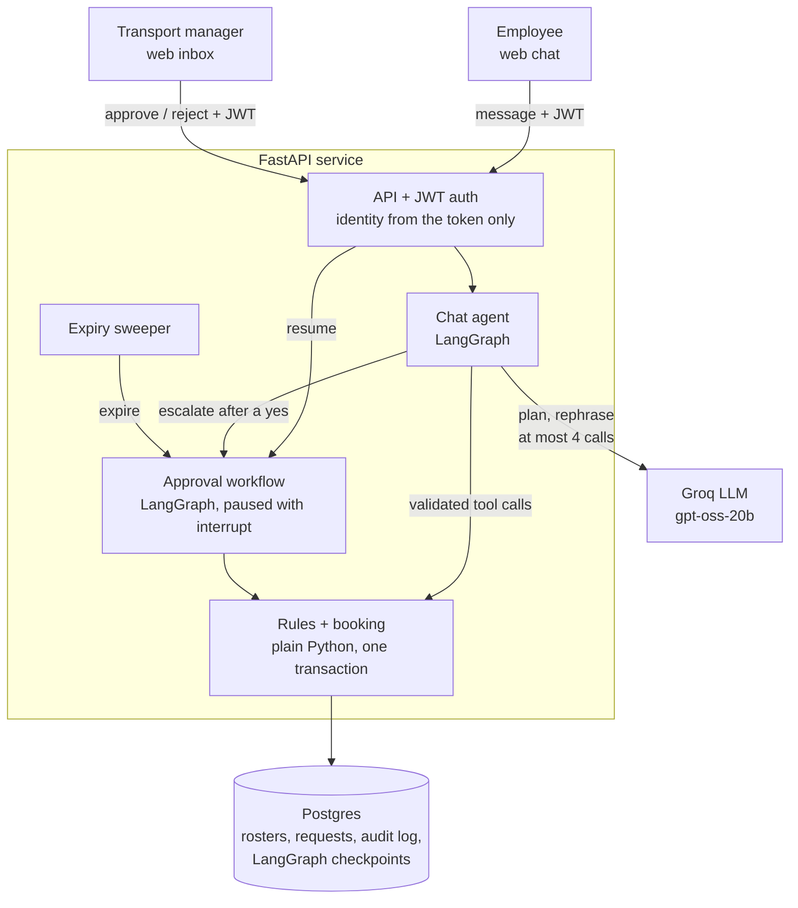
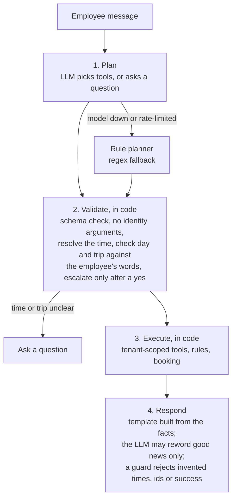
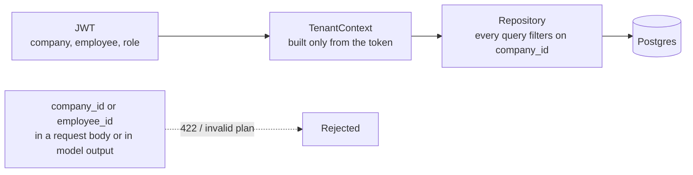
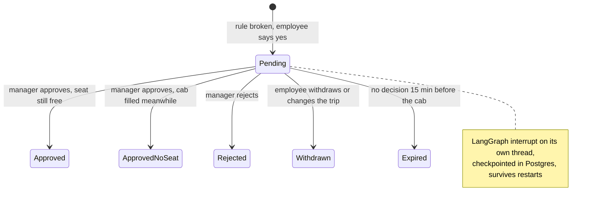
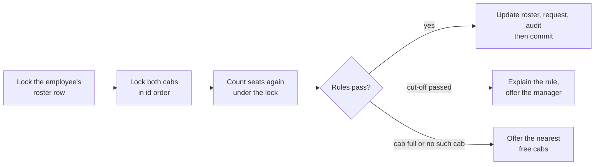

# Shiftly: shift-change request agent

A chat agent for office-cab shift changes. An employee writes "move my drop to 7:30 pm"
or "I'm on leave tomorrow". The agent reads only that employee's roster and applies their
company's rules in code. Then it either makes the change, explains why not and offers the
nearest cab that works, or sends it to the transport manager and comes back with the
decision, even if the service restarts in between.

Stack: Python 3.12, FastAPI, LangGraph, Postgres, JWT · React + shadcn/ui · Groq (`openai/gpt-oss-20b`).

**Start it with one command:**

```bash
docker compose up
```

Then open **http://localhost:8000** and sign in as `arjun@globex.test`, password `cabdesk-demo`.
More accounts and options are in [Run it](#run-it).

| Submission item | Where |
|---|---|
| One-command start | `docker compose up` (above) |
| How to run, design decisions, trade-offs | This README: [Run it](#run-it), [How it works](#how-it-works), [Design decisions](#design-decisions), [Trade-offs](#trade-offs) |
| Evaluation report | [EVALUATION.md](EVALUATION.md) (also as [PDF](EVALUATION.pdf)): scenarios, method, results, known failures, limitations, a trade-off |
| Evaluation set (JSONL: `id, input, expected, actual, pass, notes`) | [evaluation.jsonl](evaluation.jsonl) (real model, 31/37) · [backend/eval/results.jsonl](backend/eval/results.jsonl) (scripted model, 41/41) |
| 2-minute screen recording | _link_ |

---

## How it works

**The LLM understands and talks. Code decides.**

### Architecture



- **API** turns the JWT into a `TenantContext` (company, employee, role). Nothing else can set identity.
- **Chat agent** is a fixed four-step LangGraph: the LLM plans, code does everything that decides.
- **Rules + booking** is plain Python: the cut-off and seat rules, and the only code that writes the roster.
- **Approval workflow** pauses on its own thread until a manager, the employee or the sweeper resumes it; its checkpoint is in Postgres, so it survives a restart.
- **Postgres** is the only store: domain data, row locks, the audit log and LangGraph checkpoints. No Redis.

### One message, step by step



### Where the LLM is used, and where plain code is better

| Job | Who does it | Why |
|---|---|---|
| Understanding "can I go a bit late?", "make it 8 instead", "on leave tomorrow" | LLM (planner) | Open-ended language; this is what it's good at |
| Choosing the tool | LLM, validated by code | Measured in the eval; wrong/extra args are rejected |
| Who is asking, which company | JWT only | Never from the body, never from the model |
| Cut-off, seats, same route, today/tomorrow | `rules.py` (pure functions) | Must be exact and identical every time |
| Applying the change | `booking.py` (one transaction, row locks) | Correctness under concurrency |
| Whether to escalate | Code checks the employee said yes to *this* offer | Model can't escalate on its own |
| Times like "8" next to a 19:00 drop | `timeparse.py` | Deterministic; unclear times become a question |
| The reply | Template from facts; LLM may only rephrase successful or info-only turns | A confident wrong confirmation is worse than none |

### Staying under 4 LLM calls and 5 seconds

- Fixed pipeline, not a free agent loop: **plan (1) + optional retry (1) + optional rephrase (1) = 3 max**. A per-message `LLMBudget` raises on a 5th call; every test turn asserts `llm_calls <= 4`. Typical turn: 1–2 calls (refusals and questions: 1; successful changes: 2).
- Time budget per message: planner timeout 2.5 s, each tool 1.5 s (reads retried once; a booking that times out is re-checked so the employee is never told "nothing changed" when it did), rephrase 1.5 s and **skipped when less than 1.5 s of the 4.5 s budget is left** (the template is used). A hard 10 s turn timeout returns a plain message instead of hanging.
- Groq's free tier is fast enough for this pipeline. Measured p95: **1.51 s** ([EVALUATION.md](EVALUATION.md)).

### Multi-company isolation



- `TenantContext(company_id, employee_id, role)` is built only from the verified JWT and passed explicitly to every repository function; every tenant query filters by `company_id`. There is no unscoped query for tenant data.
- Request bodies are `extra="forbid"`: a body with `company_id` is a 422.
- Tool argument schemas contain only business fields (day, pickup/drop, time); a model emitting `employee_id`/`company_id` makes the plan invalid.
- Cross-tenant lookups return 404 (no existence leak). Cabs belong to a company, so seat counts never mix.
- Proven by tests: `test_repo_isolation.py`, `test_auth.py`, `test_chat_api.py::test_foreign_conversation_404`, `test_chat_flow.py::test_model_identity_args_never_reach_tools`, `test_approval.py::test_other_company_manager_404`, and the 7 `iso-*` eval cases.

### Rules (sample data)

| | Acme Tech | Globex Corp |
|---|---|---|
| Drop changes, at least | 2 h before the cab | 1 h |
| Pickup changes, at least | 4 h | 2 h |
| Seats filled per cab (policy cap on a 6-seat vehicle) | 4 | 6 |
| Manager may override the cut-off | yes | yes |

The cut-off applies to both the booked cab and the target cab. A cab that has
already left can't be changed at all. A full cab or a non-existent slot is never escalated (a manager can't create a seat); the agent
offers the two nearest cabs that pass every rule.

### Manager approval and restarts



Each escalation starts its own LangGraph thread (`approval:<request id>`) that
stops at `interrupt()`; the checkpoint and the request row are both in Postgres.
The manager endpoint looks the request up **within the manager's company**,
resumes that thread with `Command(resume=...)`, the decision is applied (approval
overrides the cut-off and re-checks the seat) and the result is posted into the
employee's conversation, both the message log and the chat graph's memory, so
"ok, then 9?" works next. The same thread is resumed by the employee
("withdraw it") or by an expiry sweeper (no decision 15 min before the earlier of the booked and requested cab:
original trip kept, employee told to call the desk).
If the employee makes a different change themselves while waiting, the pending
request is withdrawn, so a later approval can't undo it.

Restart proof: `test_approval.py::test_restart_then_manager_approves` shuts the
app down, boots a new one on the same DB, asserts the workflow is still paused at
`await_decision`, approves, and checks the message in the same conversation.
Also checked manually with `docker compose restart api` between escalation and approval.

### When things go wrong

| Situation | What the employee sees |
|---|---|
| Roster / cab schedule / booking times out or errors | "I couldn't reach the cab schedule just now, so nothing was changed. Your 19:00 drop is still booked. Please try again in a minute, or call the transport desk if it's urgent." |
| LLM down / rate-limited | "I'm having trouble understanding messages right now. Nothing was changed. …" |
| Model output malformed twice | "Sorry, I didn't quite get that. Could you tell me the time, and whether it's your pickup or drop?" |
| Cab filled up during approval | "Your manager approved request SCR-…, but the 20:30 cab filled up in the meantime. Your 19:00 drop is still booked. …" |
| Stuck in approval | Status shows when it was sent; expiry message before the cab |
| Double-clicked send | 409 "Still working on your last message." (one turn per conversation, Postgres advisory lock) |
| Anything unexpected | Plain message + reference id; the trace stays in the server log |

The "Simulate failures" panel in the UI switches these on for the demo.

### Bonus: last seat and double-submit



`booking.py` locks the employee's roster row, then the cab rows in ascending id
order (no deadlocks), re-reads occupancy under the lock, then writes. Two people
racing for the last seat: exactly one gets it, the other gets "full" and the
nearest cabs. The same change submitted twice: the second sees it already done
and returns the same request id; pending escalations are also protected by a
partial unique index. Proven by `test_concurrency.py` with real concurrent
transactions on Postgres (run repeatedly while building).

---

## Design decisions

1. **The LLM understands and talks; code decides.** The model reads the message and picks a
   tool. Who is asking, which trip, the cut-off, seats, the booking and the wording of a refusal
   are all plain Python.
2. **A fixed LangGraph pipeline, not a free agent loop.** Plan → validate → execute → respond.
   That gives at most 3 LLM calls per message (the limit is 4) and predictable latency.
3. **Identity only from the JWT.** A `TenantContext` built from the token is passed to every
   repository call, and every tenant query filters by `company_id`. Request bodies and tool
   arguments can't carry `company_id` or `employee_id`.
4. **Code checks the model against the employee's words.** If the employee didn't name a day,
   code picks their next trip that hasn't left. A "tomorrow" or "pickup" the employee never said
   is corrected. A time that has already passed gets a plain question back.
5. **Escalation needs a yes, enforced in code.** If the model escalates before the employee was
   told the rule and agreed, code ignores it and explains the rule first.
6. **Manager approval is its own LangGraph thread.** It pauses at `interrupt()`, its checkpoint
   is in Postgres, and it resumes with `Command(resume=...)` when the manager decides, the
   employee withdraws or the request expires. The chat stays usable in the meantime.
7. **Postgres is the only store.** Domain data, row locks, idempotency (a unique index), the
   audit log and the LangGraph checkpoints all live there. No Redis.

## Trade-offs

| I chose | Over | What I gave up | Why |
|---|---|---|---|
| Fixed planner/executor pipeline | Free ReAct loop | The model can't chain arbitrary tool calls | Hard call cap, predictable latency, and facts never come from the model |
| **No seat hold during approval** | Holding the seat | An approved change can find the cab full | Evening seats are scarce and approvals slow; that case is handled and tested. Details in [EVALUATION.md](EVALUATION.md#a-trade-off-i-dont-hold-the-seat-while-the-manager-decides) |
| Templates as the source of truth | Free-form LLM replies | Replies are less varied | A confident wrong confirmation is worse than a plain one; the LLM may only reword good news, and a guard checks it |
| App-level tenant scoping | Postgres row-level security | One layer of defence instead of two | Easier to read and test; RLS would be my next step |
| Postgres only | Postgres + Redis | No pub/sub; the UI polls for new messages | One thing to run, and it already gives locks and checkpoints |
| Small free model (`gpt-oss-20b` on Groq) | A larger paid model | It needs more help from code, and the free tier rate-limits | p95 1.5 s; when it's down or limited, a regex planner takes over and the same rules apply |

## Evaluation

Full report: **[EVALUATION.md](EVALUATION.md)**.

- **Scripted model, 41/41.** The model's tool calls are written into each case, so this proves
  the rules, isolation, approval-after-restart, failure handling and races hold whatever the
  model says. Plus 202 automated tests.
- **Real model, 26/37 → 31/37** across two runs. Each failure led to a code change: the day is
  picked in code, and the model's choices are checked against the employee's words.
- **Latency:** p95 **1.51 s**, max 2 LLM calls per message (targets: 5 s, 4 calls).
- **Never failed in any run:** a change applied against a rule, or data crossing between companies.

---

## Run it

```bash
docker compose up
```

Open **http://localhost:8000**. Scroll the landing page to see how it works, then sign in.
The password for every demo account is `cabdesk-demo`.

- It works **without an API key**: a small offline planner (regex) stands in for the LLM.
- For the real agent, copy `.env.example` to `.env`, set `GROQ_API_KEY` (free at console.groq.com), and run `docker compose up` again.
- Port 8000 busy? `APP_PORT=8010 docker compose up`.
- The demo clock starts at **17:30 India time** whatever the wall clock says (`DEMO_START` in
  `.env`), so the evening scenarios always work. "Simulate failures → Reset sample data" in the
  app re-seeds the data and sets the clock back to 17:30.

| Email | Who | Try |
|---|---|---|
| `arjun@globex.test` | Globex employee (1 h cut-off) | "move my drop to 7:30 pm" → applied |
| `rohan@acme.test` | Acme employee (2 h cut-off) | same message → rule explained → "yes" → sent to manager |
| `kavita@acme.test` | Acme transport manager | approve / reject Rohan's request |
| `asha@acme.test` | Acme employee | "move my drop to 8 pm" → cab full, nearest free cabs offered |
| `farah@globex.test` | Globex transport manager | sees only Globex requests |

Also `meera@acme.test`, `sneha@globex.test`, `vikram@globex.test`. Passwords are stored as
salted scrypt hashes; the token carries the company and role from the database.

### Tests and evaluation

```bash
docker compose run --rm tests                          # 202 tests, fake LLM, real Postgres
docker compose run --rm tests python -m eval.run       # scripted run -> backend/eval/results.jsonl
docker compose run --rm tests python -m eval.run --mode real --pause 15   # real model (needs key) -> backend/eval/results.real.jsonl
docker compose run --rm tests python -m eval.latency --n 40 --pause 15    # p95 latency with the real model
docker compose run --rm tests python -m eval.summary   # compare the stored real-model runs
```

The cases are defined in `backend/eval/cases.jsonl`. `evaluation.jsonl` is a copy of the second
real-model run (`backend/eval/history/2-real-gpt-oss-20b-day-in-code.jsonl`). The full design
is in [docs/design.md](docs/design.md).
